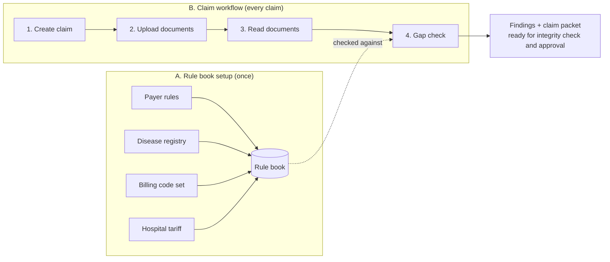
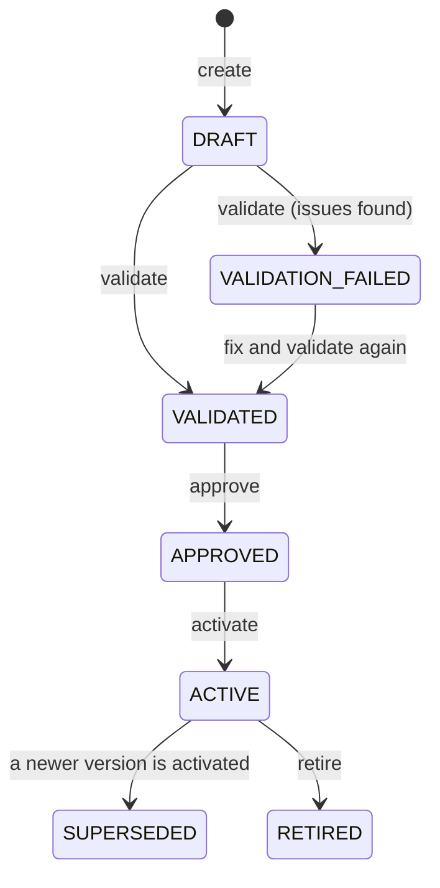
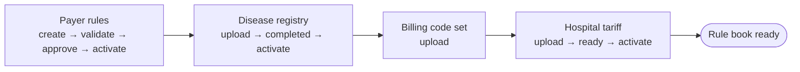
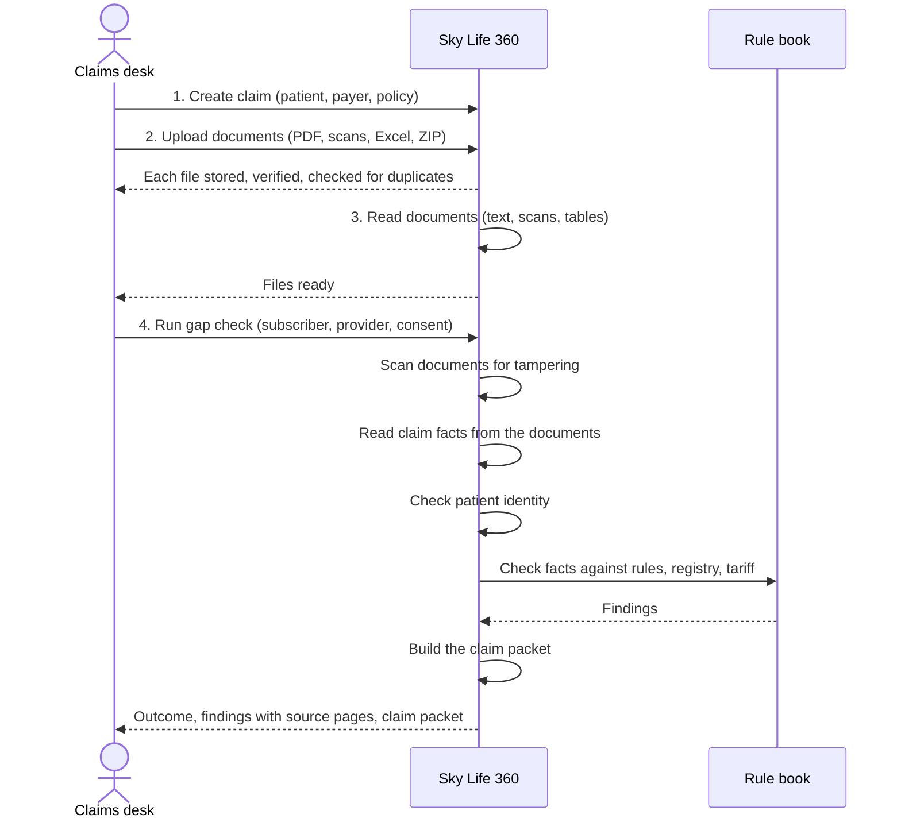
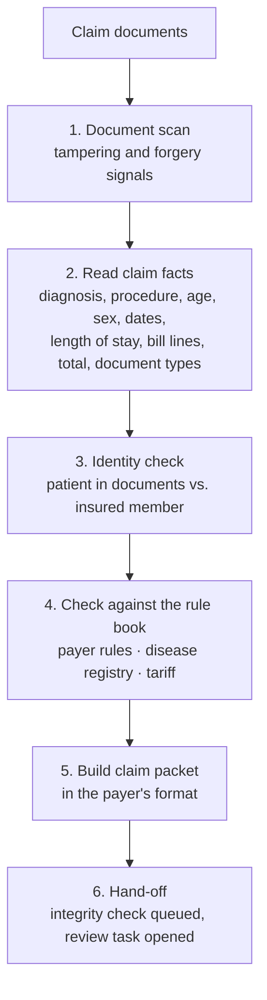
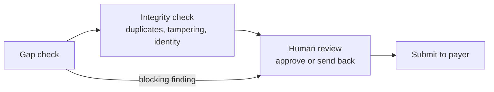

# Sky Life 360 — From Claim Documents to Gap Check

**How the platform checks a hospital insurance claim against payer rules before it is submitted**

---

## 1. Overview

Hospitals lose time and money when claims are returned by the insurer for missing documents, rule violations or billing mismatches. Sky Life 360 checks each claim **before submission** and tells the hospital exactly what will block it or needs fixing, with a link back to the page each finding came from.

The work happens in two parts:

| Part | Who | How often | What happens |
|---|---|---|---|
| **A. Rule book setup** | Hospital administrator | Once, then when rules or prices change | Load the payer rules, disease registry, billing codes and hospital tariff |
| **B. Claim workflow** | Claims desk staff | For every claim | Create claim → upload documents → documents are read → gap check |



---

## 2. Part A — Setting up the rule book

The gap check can only be as good as the rules it checks against. Four kinds of reference data make up the rule book:

| Reference data | What it contains | What it lets the platform check |
|---|---|---|
| **Payer rules** | The insurer's conditions, written as rules: eligibility, exclusions, required documents, limits, pre-authorisation | "Is this claim allowed under the payer's policy?" |
| **Disease registry** | Standard diagnosis codes (ICD-10), typical length of stay and the diagnostics each specialty must document for pre-authorisation | "Is the diagnosis known, is the stay reasonable, are the required tests documented?" |
| **Billing code set** | The procedure / service codes used on bills (e.g. CPT, PM-JAY packages) | "Are the bill lines recognised codes?" |
| **Hospital tariff** | The hospital's price list per facility and room category | "Is each bill line priced according to the tariff?" |

All four are loaded through the platform's administration APIs by an **Admin** or **Super Admin** user. Every change is versioned and recorded in the audit log.

### 2.1 Payer rules

#### What a rule looks like

```json
{
  "rule_key": "pci-needs-angiogram",
  "title": "PCI needs an angiogram report",
  "rule_type": "requirement",
  "scope": { "procedure_codes": ["PCI001"] },
  "condition": { "some": [ { "var": "claim.document_types" },
                           { "in": [ { "var": "" }, ["angiogram_report"] ] } ] },
  "action": "query",
  "message": "An angiogram report is required for PCI.",
  "payer_id": null,
  "effective_from": "2026-04-01",
  "source_reference": { "document": "Payer package rules", "section": "4.2",
                        "version": "1", "issued_on": "2026-03-15" }
}
```

| Field | Meaning |
|---|---|
| `rule_key` | Unique, readable name of the rule |
| `rule_type` | `eligibility`, `exclusion`, `requirement`, `limit`, `preauthorization`, `consistency`, `fraud_pattern` |
| `scope` | Which claims the rule applies to (specific procedure or diagnosis codes, or all claims) |
| `condition` | The test, written in JSON Logic. **True = the claim passes** |
| `action` | What happens when the claim fails the test (below) |
| `message` | The text the claims desk sees |
| `payer_id`, `plan_id`, `region` | Limit the rule to one payer, plan or region (empty = applies to all) |
| `effective_from` / `effective_to` | The dates the rule is in force. Claims are checked against the rules in force **on the date of service** |
| `source_reference` | Where the rule comes from in the payer's documents (for traceability) |

| `action` | Effect on the claim |
|---|---|
| `reject` | **Blocking.** The payer will reject the claim |
| `require_preauth` | Fixable: pre-authorisation is needed |
| `query` | Fixable: the payer will query the claim (e.g. a missing document) |
| `flag_review` | Fixable: flagged for human review |

#### The rule lifecycle

Every rule goes through a controlled lifecycle before it is used, so that no rule takes effect without validation and approval.



- **Validate** checks the rule's logic, the codes it uses, and conflicts or duplicates with other rules.
- **Approve** is the sign-off step.
- **Activate** puts the rule in force from its `effective_from` date.
- Changing a rule creates a **new version**. The old version stays on record, and past claims remain explainable.

#### Steps to load a rule

| Step | API |
|---|---|
| 1. Create the rule (version 1, status DRAFT) | `POST /api/v1/rules` |
| 2. Validate | `POST /api/v1/rules/{rule_key}/versions/1/validate` |
| 3. Approve | `POST /api/v1/rules/{rule_key}/versions/1/approve` |
| 4. Activate | `POST /api/v1/rules/{rule_key}/versions/1/activate` |
| Check what is in force | `GET /api/v1/rules/active` |

Other rule APIs:

| Purpose | API |
|---|---|
| Load many rules at once | `POST /api/v1/rules/import` |
| Change a rule (new version) | `POST /api/v1/rules/{rule_key}/versions` |
| Retire a rule | `POST /api/v1/rules/{rule_key}/versions/{version}/retire` |
| Test a claim against the rules without saving | `POST /api/v1/rules/evaluate` |

### 2.2 Disease registry

| Step | API |
|---|---|
| 1. Upload the registry workbook (Excel: specialties, diseases and treatments, pre-authorisation standards) | `POST /api/v1/claims/registry/ingest` |
| 2. Wait until processing is `COMPLETED` (an error report is available if rows are rejected) | `GET /api/v1/claims/registry/datasets/{dataset_id}` |
| 3. Activate it (the previous version is superseded) | `POST /api/v1/claims/registry/datasets/{dataset_id}/activate` |
| Look up a diagnosis | `GET /api/v1/claims/registry/diseases?q=` |

### 2.3 Billing code set

| Step | API |
|---|---|
| Upload the code list (CSV: code, description, category) with its code system and version | `POST /api/v1/charges/code-sets` |
| List loaded code sets | `GET /api/v1/charges/code-sets` |

### 2.4 Hospital tariff

| Step | API |
|---|---|
| 1. Upload the tariff (Excel, CSV or JSON) for a facility, with its version and effective date | `POST /api/v1/charges/masters` |
| 2. Wait until it is ready, and review exceptions (unmapped or unusual lines) | `GET /api/v1/charges/masters/{master_id}` · `…/exceptions` |
| 3. Activate it (or upload with auto-activate) | `POST /api/v1/charges/masters/{master_id}/activate` |
| Look up a price | `GET /api/v1/charges/prices` |

### 2.5 Setup checklist



- [ ] At least one payer rule is **ACTIVE** for the dates of service you'll check
- [ ] A disease registry dataset is **active**
- [ ] The billing code set is loaded
- [ ] The tariff for each facility is **ACTIVE**

---

## 3. Part B — The claim workflow



### Step 1 — Create the claim

The claims desk opens a new claim with the patient ID and the claim details: patient, procedure, scheme, payer, TPA, policy number, treating doctor and estimated amount. Creating the claim also gives the hospital access to that patient's records.

| Purpose | API |
|---|---|
| Create a claim | `POST /api/v1/claims` |
| Claims list with filters (stage, payer, search) and summary counts | `GET /api/v1/claims` |
| One claim's details | `GET /api/v1/claims/{claim_id}` |

### Step 2 — Upload documents

Staff drop the claim's documents: discharge summary, reports, bills, scanned pages, or a whole ZIP.

- **Formats:** PDF, Word, Excel, CSV, JSON, text, images (PNG, JPG), ZIP. Up to 50 MB per file and 50 files per upload.
- **Per file:** each file is stored securely and verified. ZIP files are opened and each file inside is checked.
- **Duplicates:** the same file uploaded twice for a patient is detected and not stored again.
- **Results:** the result for each file is shown: accepted, duplicate, not allowed, or failed (and can be retried).

| Purpose | API |
|---|---|
| Upload files to the claim | `POST /api/v1/ingestion/upload` (files + patient ID + claim ID) |
| All documents on the claim | `GET /api/v1/claims/{claim_id}/documents` |
| Open a document | `GET /api/v1/files/{file_id}/download` |
| Remove a document from the claim | `DELETE /api/v1/claims/{claim_id}/documents/{file_id}` |

### Step 3 — Read documents

The platform reads the text of every document in the background, including scanned pages and tables. Staff can see the progress and view the text of any page. A file that couldn't be read can be retried.

| Purpose | API |
|---|---|
| Reading status per document | `GET /api/v1/claims/{claim_id}/documents` |
| Text of one page | `GET /api/v1/files/{file_id}/text?page=` |
| Retry files that failed | `POST /api/v1/ingestion/batches/{batch_id}/retry` |

### Step 4 — Gap check

Staff confirm the payer, the insured member (member ID, name, date of birth, gender), the provider and the patient's consent, then run the check. One request runs the whole chain:



Every fact read from the documents keeps a link to the page it came from, so every finding can be traced back to its source.

| Purpose | API |
|---|---|
| Preview the facts read from the documents (nothing saved) | `POST /api/v1/claims/intake/extract` |
| Run the gap check | `POST /api/v1/claims/intake` |
| Reload a gap check | `GET /api/v1/claims/intake/{intake_id}` |
| Findings | `GET /api/v1/claims/gaps/runs/{gap_run_id}` |
| Download the gap report | `GET /api/v1/claims/gaps/runs/{gap_run_id}/report` |
| Claim packet | `GET /api/v1/claims/packets/assemblies/{packet_id}` |
| Download the claim packet | `GET /api/v1/claims/packets/assemblies/{packet_id}/download` |

---

## 4. Reading the result

### Outcome

| Outcome | Meaning | What the claims desk does |
|---|---|---|
| 🟢 **Eligible** | No findings | Continue to the integrity check |
| 🟠 **Conditional** | Only fixable gaps | Fix the listed items (e.g. add a document), or continue and note them |
| 🔴 **Not eligible** | At least one blocking finding: the payer will reject the claim | Review. The claim is sent to an approver with a "reject" recommendation |

### Findings

Each finding shows:

| Item | Example |
|---|---|
| Severity | **MUST FIX** (blocking) or **SHOULD FIX** (fixable) |
| What is wrong | "An angiogram report is required for PCI." |
| How to fix it | "Provide the information or documents the rule requires." |
| Where it comes from | The payer rule (with its version), the disease registry, or the tariff |
| Source page | The document and page the fact was read from |

### Identity check

The patient named in the documents is compared with the insured member entered on the claim: name, age and sex.

| Result | Meaning |
|---|---|
| **Match** | Documents and policy holder agree |
| **Mismatch** | The documents may belong to someone else. Flagged for the reviewer |
| **Not found** | No patient details were found in the documents |

### Claim packet

| Status | Meaning |
|---|---|
| **Ready** | Built in the payer's format, ready for the integrity check and approval |
| **Needs review** | Built, but parts need a human check |
| **Blocked** | Not built for submission because of a blocking finding |

---

## 5. Worked example

**Rule book:** three payer rules (adults only · cosmetic procedures excluded · a PCI procedure needs an angiogram report), a disease registry, a billing code set and a cardiology tariff.

**Claims:** heart-attack patients treated with angioplasty (PCI), each with a discharge summary, an angiogram report and a final bill.

| Claim | What's different | Outcome | Main finding | Identity | Packet |
|---|---|---|---|---|---|
| A | Complete documents | 🟠 Conditional | Pre-authorisation diagnostics for cardiology (Echo, Troponin) not documented | Match | Ready |
| B | No angiogram report | 🟠 Conditional | **"An angiogram report is required for PCI."** (payer rule) | Match | Ready |
| C | Patient is 10 years old | 🔴 Not eligible | **"The subject must be an adult."** (payer rule, blocking) | Match | Blocked: sent to review with a reject recommendation |
| D | Insured member's name differs from the documents | 🟠 Conditional | — | **Mismatch**: flagged for the reviewer | Ready |

Facts read automatically from claim A's documents:

| Fact | Value | Read from |
|---|---|---|
| Primary diagnosis | I21.9 — Acute myocardial infarction | Discharge summary, page 1 |
| Procedure | PCI001 — Primary PTCA with stent | Discharge summary, page 1 |
| Age / sex | 54 / female | Discharge summary, page 1 |
| Admission type | Emergency | Discharge summary, page 1 |
| Length of stay | 3 days | Discharge summary, page 1 |
| Billed amount | ₹1,51,500 | Final bill, page 1 |
| Documents present | Discharge summary, angiogram report, final bill | Headings and file names |

---

## 6. After the gap check

The gap check hands the claim on automatically:



---

## 7. API summary

All endpoints are under `/api/v1`, require a signed-in user (or an API key), and are scoped to the hospital's own data.

| Area | Method | Endpoint | Used for |
|---|---|---|---|
| **Rules** | POST | `/rules` | Create a rule |
| | POST | `/rules/import` | Load many rules |
| | POST | `/rules/{key}/versions/{v}/validate` · `/approve` · `/activate` · `/retire` | Rule lifecycle |
| | GET | `/rules/active` | Rules in force |
| **Registry** | POST | `/claims/registry/ingest` | Upload the disease registry |
| | GET | `/claims/registry/datasets/{id}` | Processing status |
| | POST | `/claims/registry/datasets/{id}/activate` | Activate |
| **Billing** | POST | `/charges/code-sets` | Load a billing code set |
| | POST | `/charges/masters` | Upload a hospital tariff |
| | POST | `/charges/masters/{id}/activate` | Activate a tariff |
| **Claims** | POST · GET | `/claims` | Create · list claims |
| | GET | `/claims/{id}` | Claim details |
| | GET | `/claims/{id}/documents` | Documents on the claim |
| | DELETE | `/claims/{id}/documents/{file_id}` | Remove a document |
| **Documents** | POST | `/ingestion/upload` | Upload files |
| | POST | `/ingestion/batches/{id}/retry` | Retry failed files |
| | GET | `/files/{id}/download` · `/files/{id}/text` | Open a file · read its text |
| **Gap check** | POST | `/claims/intake/extract` | Preview the facts |
| | POST | `/claims/intake` | Run the gap check |
| | GET | `/claims/intake/{id}` | Gap check status |
| | GET | `/claims/gaps/runs/{id}` · `/report` | Findings · gap report |
| | GET | `/claims/packets/assemblies/{id}` · `/download` | Claim packet · download |
